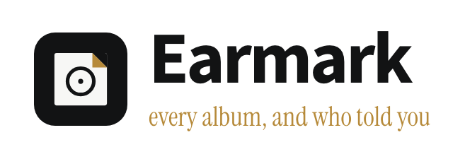
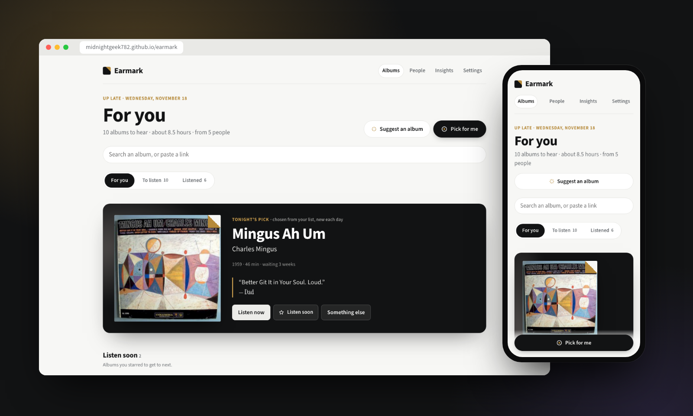
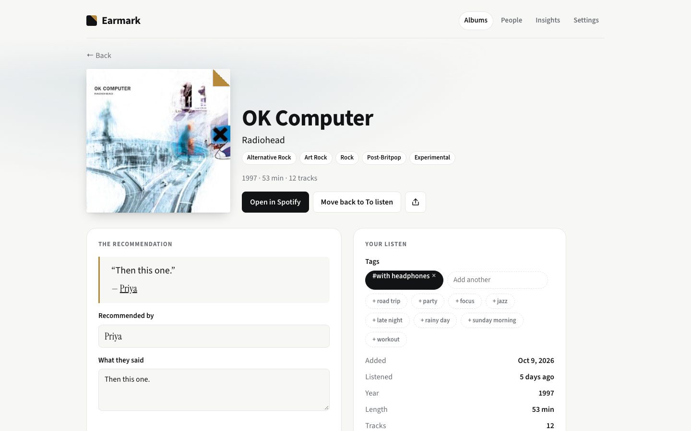
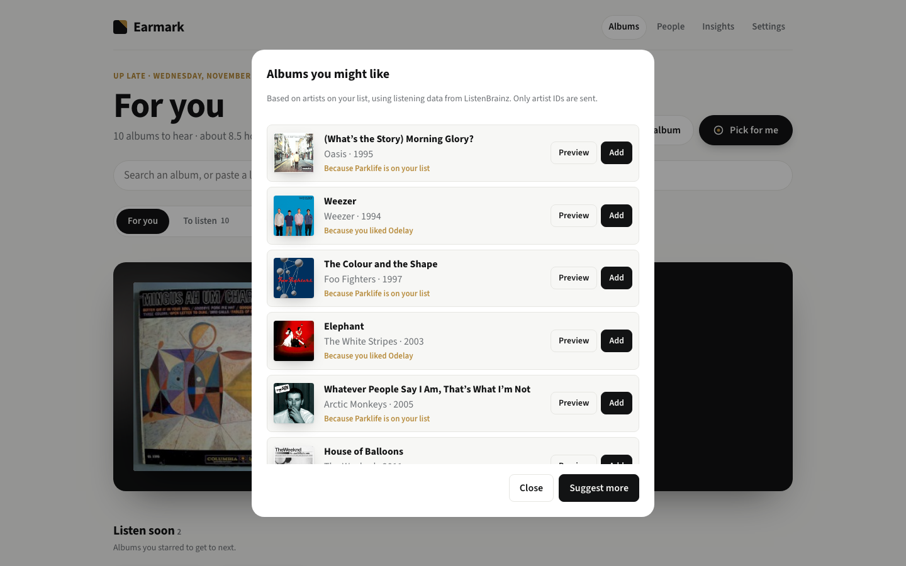
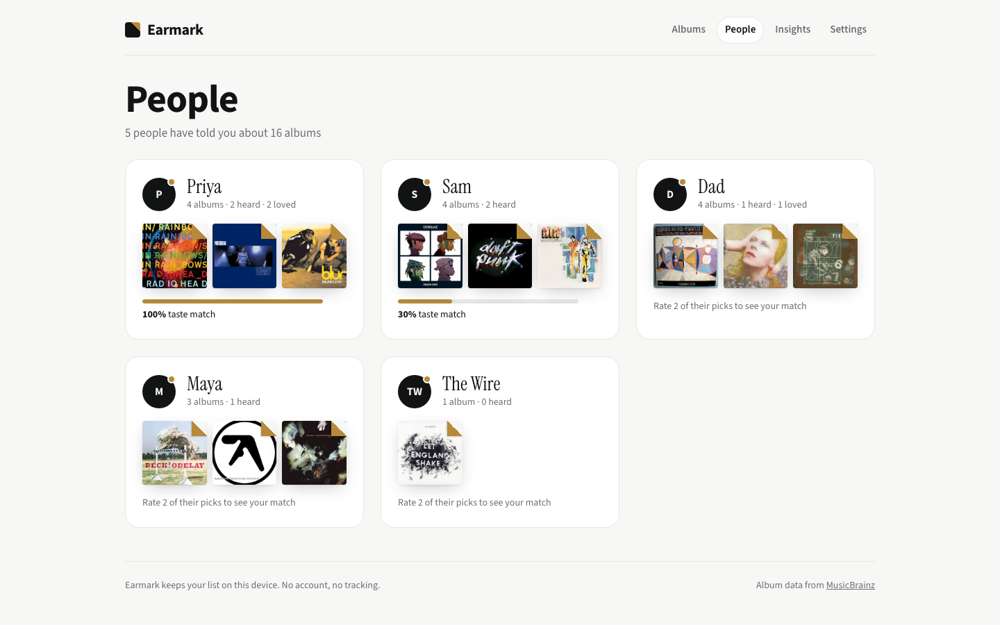
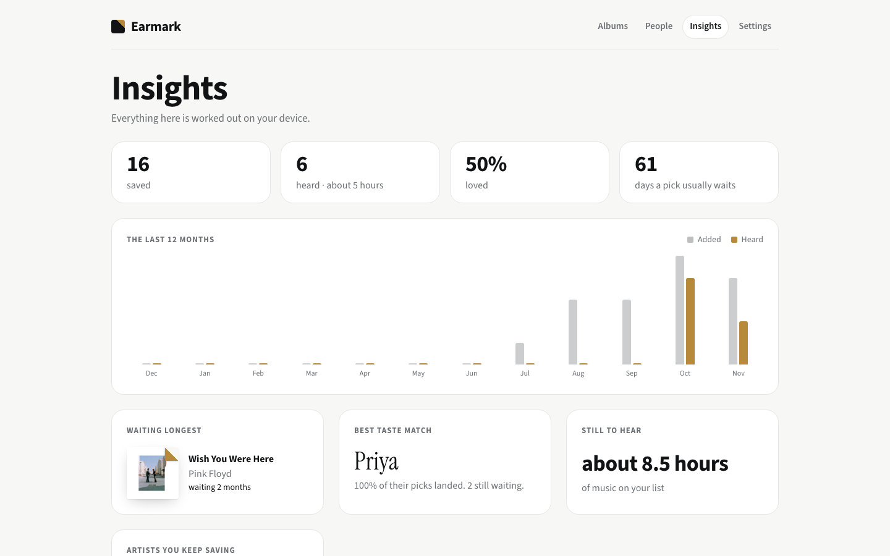
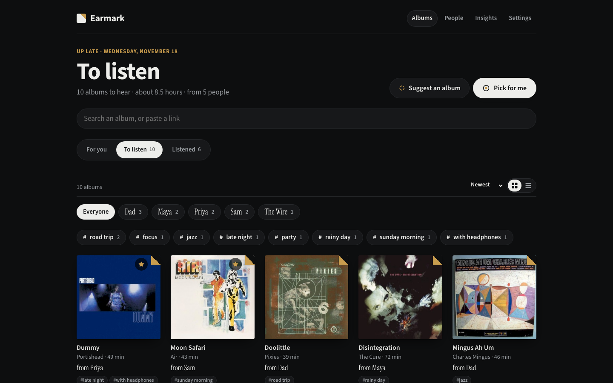
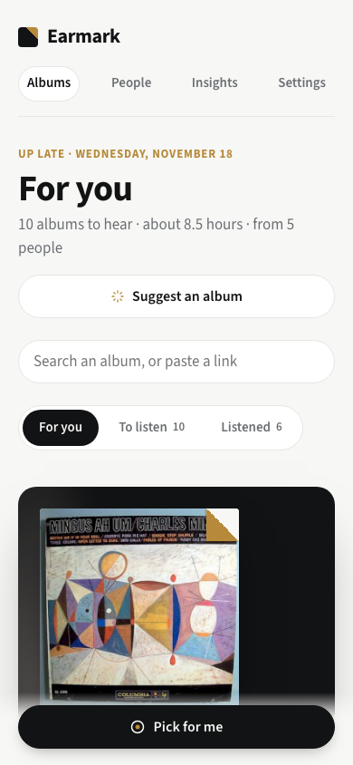
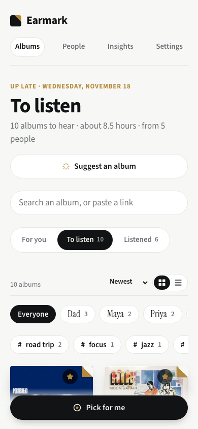

<p align="center">
  <a href="https://midnightgeek782.github.io/earmark/">
    <picture>
      <source media="(prefers-color-scheme: dark)" srcset="docs/brand/logo-dark.png">
      
    </picture>
  </a>
</p>

<p align="center">
  <strong>A to-listen list for albums that remembers who told you about them.</strong><br>
  Free, open source, no account. Works in any browser and offline.
</p>

<p align="center">
  <a href="https://midnightgeek782.github.io/earmark/"><strong>Open Earmark →</strong></a>
  &nbsp;·&nbsp;
  <a href="#run-it-locally">Run it locally</a>
  &nbsp;·&nbsp;
  <a href="CONTRIBUTING.md">Contribute</a>
</p>

<p align="center">
  <a href="https://github.com/midnightgeek782/earmark/actions/workflows/ci.yml"></a>
  
  
</p>

<p align="center">
  
</p>

A friend texts you an album. A review mentions one. A podcast plays a song you want to hear in full. Earmark keeps them all in one list, remembers **who** recommended each one and **what they said**, and helps you choose something when you finally have time to listen.

## What it does

- **Save albums in seconds.** Search by name, or paste a Spotify, Apple Music or Bandcamp link. Type an artist's name to see just their studio albums.
- **Remember who told you.** Every album keeps the person, their words ("Track 3 is the one"), and your own verdict and notes once you've heard it.
- **Decide what to play.** A daily pick, **Pick for me** with a time limit ("I have 45 minutes"), and shelves like _Listen soon_, _Short listens_ and _Waiting longest_.
- **Discover more.** **Suggest an album** finds records by artists similar to the ones you save, using open listening data from ListenBrainz.
- **Know what you're getting into.** Album pages show genres, a short Wikipedia description, the track list and length.
- **See whose taste matches yours.** The People page shows how often each person's picks land with you.
- **Yours to keep.** Your list lives in your browser. Export it as a file (or a spreadsheet) any time.

## A quick tour

<table>
  <tr>
    <td width="50%"></td>
    <td width="50%"></td>
  </tr>
  <tr>
    <td><b>Every album page</b> keeps who told you and what they said, plus genres, tags, a Wikipedia summary and the track list.</td>
    <td><b>Suggest an album</b> recommends new records, each with a reason, like "Because you liked Odelay".</td>
  </tr>
  <tr>
    <td></td>
    <td></td>
  </tr>
  <tr>
    <td><b>People</b>: everyone who recommends you music, and how often their picks land.</td>
    <td><b>Insights</b>: what you add and hear over time, worked out on your device.</td>
  </tr>
  <tr>
    <td></td>
    <td>
      <p align="center">
        
        &nbsp;
        
      </p>
    </td>
  </tr>
  <tr>
    <td><b>Dark mode</b>, filters by person and #tag, and a compact list view.</td>
    <td><b>Made for your phone.</b> Add it to your home screen and it opens like an app, even offline.</td>
  </tr>
</table>

## How it compares

|                              | Earmark     | Side B | Record Club | albumz             |
| ---------------------------- | ----------- | ------ | ----------- | ------------------ |
| Platform                     | Any browser | iPhone | iPhone, web | Self-hosted server |
| Account needed               | No          | No     | Yes         | Yes (your server)  |
| Remembers who recommended it | Yes         | No     | No          | No                 |
| Open source                  | Yes         | No     | No          | Yes                |

## Run it locally

```sh
git clone https://github.com/midnightgeek782/earmark.git && cd earmark
npm ci
npm run dev
```

Tests: `npm test` (unit) and `npm run test:e2e` (Playwright, desktop and phone, with the network stubbed). See [CONTRIBUTING.md](CONTRIBUTING.md).

Built with TypeScript, React, Vite and Dexie (IndexedDB). No server: it's a static site on GitHub Pages.

## Privacy

Earmark has no server and no analytics. Your list never leaves your device. Network requests:

- Album searches and details from MusicBrainz (the text you type, album IDs) and covers from the Cover Art Archive.
- Optional: album suggestions from ListenBrainz (artist IDs only) and short descriptions from Wikipedia (album IDs). Both can be turned off in Settings.

## Being a good MusicBrainz citizen

Earmark sends at most one request per second to MusicBrainz, caches answers, and identifies itself through its web address. Contributors develop against recorded replies, not the live service.

## Credits

Album data from [MusicBrainz](https://musicbrainz.org), covers from the [Cover Art Archive](https://coverartarchive.org), listening data from [ListenBrainz](https://listenbrainz.org), descriptions from [Wikipedia](https://www.wikipedia.org). Album covers in the screenshots belong to their respective owners.

## License

[MIT](LICENSE)
